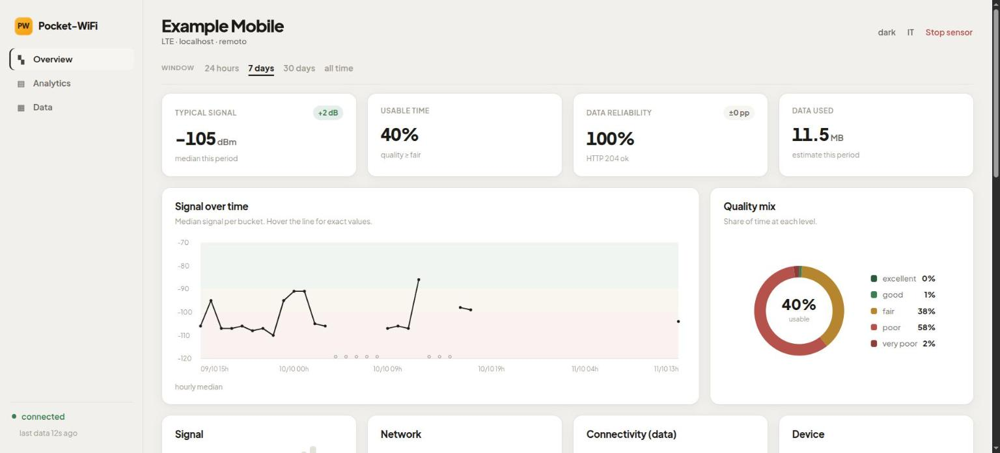
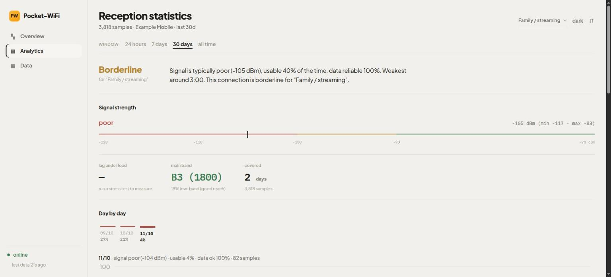
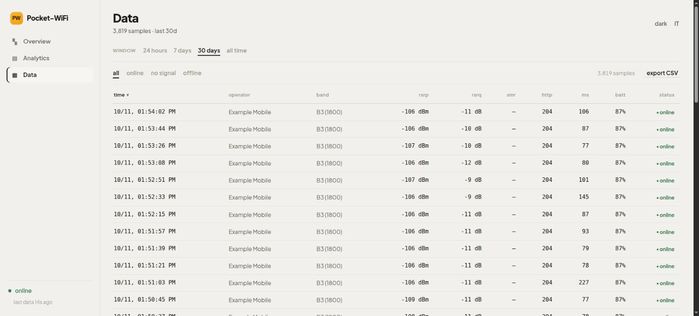

# Pocket-WiFi Monitor

[English](README.md) · Italiano

Un vecchio telefono Android con una SIM diventa un sensore remoto della qualità
della rete mobile. Misura segnale e connettività giorno e notte e manda i
campioni a un PC di casa tramite Tailscale, dove una piccola dashboard web ti
dice se quel punto è abbastanza buono prima di scegliere una SIM, un contratto
o un router 4G/5G.




## Avvio rapido

Sul PC (Python 3.9+, Tailscale):

```bash
export POCKET_WIFI_TOKEN="$(python3 -c 'import secrets; print(secrets.token_urlsafe(32))')"
cd collector && ./start.sh        # dashboard su http://127.0.0.1:8099
```

Sul telefono (Termux e Termux:API da F-Droid, Tailscale nella stessa tailnet):

```bash
pkg install python termux-api && termux-setup-storage
# copia agent/phone_agent.py, bands.py e run_agent.sh in Download/, poi:
export POCKET_WIFI_COLLECTOR='http://100.x.y.z:8099'   # IP Tailscale del PC
export POCKET_WIFI_TOKEN='lo-stesso-token-del-PC'
bash ~/storage/shared/Download/run_agent.sh
```

Tieni il telefono in carica. Permessi, impostazioni della batteria e avvio
automatico dopo un riavvio sono in [docs/PHONE.md](docs/PHONE.md).

## Funzioni

- Segnale (RSRP, RSRQ, banda, cella), connettività reale e latenza, batteria e
  temperatura, misurati ogni pochi secondi.
- Non si perde nulla se il PC è spento: il telefono tiene una coda e la
  recupera appena il PC torna raggiungibile.
- Giorni di storico con viste giorno per giorno e ora per ora, per scoprire le
  ore serali deboli.
- Un verdetto semplice per un profilo d'uso (famiglia con streaming, 4K, smart
  working): va bene, al limite o non basta.
- Stop remoto e stress test a richiesta con un budget dati, più un blocco
  termico per un telefono lasciato senza sorveglianza.
- Solo libreria standard di Python e JavaScript puro. Niente database, niente
  account cloud.

<table>
  <tr>
    <td></td>
    <td></td>
  </tr>
  <tr>
    <td align="center">Analisi: verdetto e andamento giornaliero</td>
    <td align="center">Dati: tutti i campioni, filtri, export CSV</td>
  </tr>
</table>

<sub>Gli screenshot usano dati anonimizzati: non compare nessun operatore o cella reale.</sub>

## Come funziona

```text
Telefono Android (Termux)                  PC di casa
agent/phone_agent.py  ── HTTP via ──▶      collector/collector.py
coda locale             Tailscale          data/*.jsonl + dashboard
```

```text
agent/       gira sul telefono: misure, coda, decodifica delle bande
collector/   gira sul PC: ricezione, archivio, le tre pagine della dashboard
tools/       strumenti opzionali lato PC (lettura segnale via ADB, stress test in tethering)
tests/       test su dati sintetici
docs/        guide
```

## Documentazione

- [Configurazione del telefono](docs/PHONE.md): permessi, letture a schermo spento, avvio automatico
- [Uso](docs/USAGE.md): opzioni del collector, API, controllo remoto, sicurezza termica, strumenti (in inglese)
- [Leggere i numeri](docs/METRICS.md): le tre pagine e la scala del segnale (in inglese)
- [Sviluppo](docs/DEVELOPMENT.md): test e formato dei campioni (in inglese)

## Privacy

I campioni reali contengono l'operatore e gli identificativi di cella, quindi
`collector/data/` è escluso da git. Ogni API richiede il token nell'header
`X-Token` e il collector parla HTTP semplice: tienilo su Tailscale, mai su
un'interfaccia pubblica.

## Licenza

[MIT](LICENSE)
