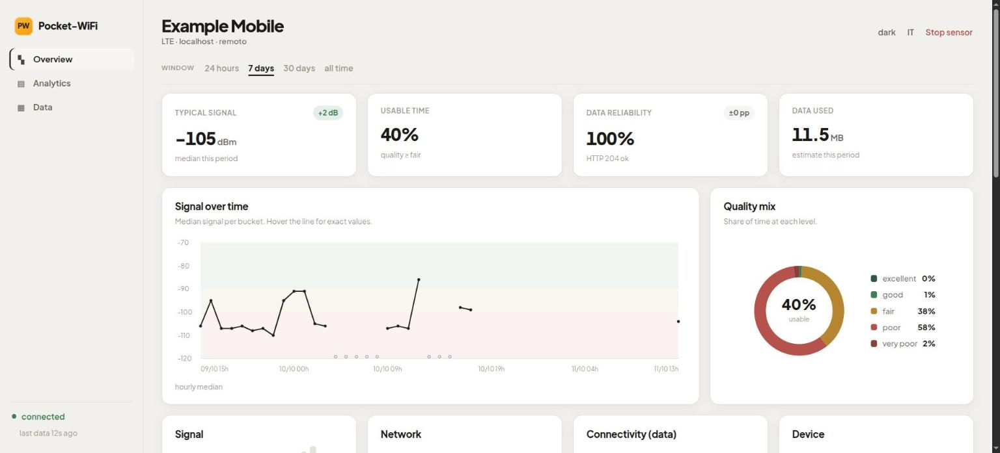
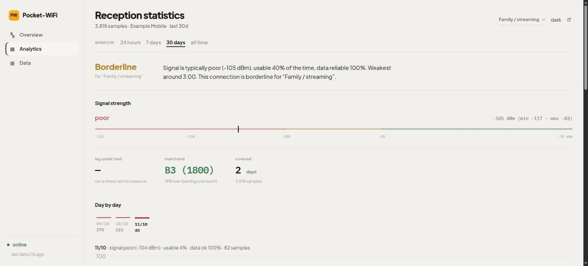
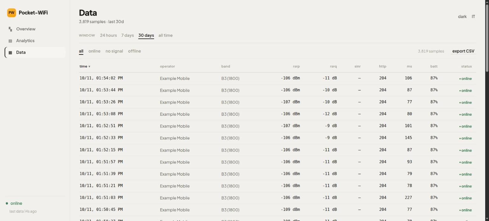

# Pocket-WiFi Monitor

[English](README.md) · **Italiano**

Trasforma un vecchio telefono Android con una SIM in un **sensore remoto della
qualità della rete mobile**. Il telefono legge segnale, cella e connettività con
Termux:API, fa un piccolo controllo di raggiungibilità e manda i campioni a un
computer di casa tramite Tailscale. Il computer li salva in locale e serve una
dashboard web: così, da qualsiasi posto, sai se in un luogo la ricezione è
abbastanza buona prima di impegnarti con una SIM o un contratto.


-success)


> **Stato:** prototipo funzionante. Le soglie radio sono indicative; quello che
> si riesce a leggere dipende dal modem, dalla versione di Android e
> dall'operatore.

## Screenshot

**Panoramica**: la vista live con KPI, grafico del segnale su un asse del tempo
reale (i buchi restano visibili), mix di qualità e card in tempo reale.



**Analisi**: il verdetto per profilo d'uso e l'andamento giorno per giorno e
ora per ora.



**Dati**: una tabella ordinabile e filtrabile di tutti i campioni, con export
CSV.



<sub>Gli screenshot usano dati sintetici e anonimizzati: non compare nessun operatore o cella reale.</sub>

## Cosa fa

- Misura il **segnale** (RSRP/RSRQ, banda, cella), la **connettività** (il
  traffico passa davvero? quanto risponde in fretta?) e lo **stato del
  dispositivo** (batteria, temperatura) a un intervallo scelto.
- Continua a funzionare anche con il PC di casa spento: i campioni finiscono in
  una coda persistente sul telefono e vengono **recuperati** appena il PC torna
  raggiungibile.
- Costruisce uno **storico** per giudicare un posto nell'arco di giorni, non di
  secondi, con il dettaglio giorno per giorno e ora per ora per scoprire le ore
  serali deboli.
- Dà un **verdetto in parole semplici per un profilo d'uso** (famiglia con
  streaming, 4K, smart working, …): "va bene / al limite / non basta".
- Esegue uno **stress test** a richiesta o programmato, con un budget dati
  esplicito.
- Niente database, niente account cloud, **nessun pacchetto Python esterno**:
  solo la libreria standard.

## Come funziona

```text
Telefono Android                           PC di casa
Termux + Termux:API                        collector.py
phone_agent.py  ──  HTTP via Tailscale  ─▶  data/ + dashboard web
```

- `agent/phone_agent.py` legge LTE, batteria e connettività, tiene una coda
  locale e reinvia i campioni ogni volta che il PC non è raggiungibile.
- `collector/collector.py` riceve campioni singoli o a blocchi, elimina i
  duplicati nello storico e serve le pagine (`/`, `/stats`, `/explore`) e le API
  `/data`, `/history`, `/recent` e `/control` (stop remoto e stress test).
- `agent/bands.py` contiene solo funzioni di supporto (libreria standard) per
  EARFCN, bande e classificazione della qualità.

## Struttura del progetto

```text
agent/        gira sul telefono (Termux): phone_agent.py, bands.py, script di avvio
collector/    gira sul PC: collector.py, dashboard.html, stats.html, explore.html, start.sh, data/
tools/        utilità lato PC: stresstest.py, adb_signal.py
tests/        test sintetici
docs/         PHONE.md (guida alla configurazione del telefono)
```

## Le tre pagine

- **Panoramica** (`/`): la vista live. Quattro KPI (segnale, tempo utilizzabile,
  affidabilità dati, dati usati), un grafico interattivo del segnale nel tempo,
  il mix di qualità, le card in tempo reale di segnale/rete/connettività/
  dispositivo e lo stress test. Il comando per fermare o riprendere il sensore
  è nella barra in alto.
- **Analisi** (`/stats`): la vista del verdetto. Consiglio per profilo d'uso,
  andamento giorno per giorno e ora per ora, uptime del sensore, conclusioni,
  una stima dedicata per il passaggio a un router 4G/5G e un breve glossario.
- **Dati** (`/explore`): una tabella ordinabile, filtrabile e paginata dei
  campioni nella finestra scelta (24 ore, 7 giorni, 30 giorni, tutto), con
  export CSV.

Ogni pagina è un unico file HTML autonomo (grafici SVG fatti a mano, nessuna
libreria di grafici), bilingue **EN/IT** e con tema chiaro/scuro. Tutte e tre
usano la stessa scala del segnale del telefono: RSRP ≥ -80 eccellente, ≥ -90
buono, ≥ -100 discreto, ≥ -110 scarso, sotto pessimo.

## Avviare il collector (PC)

Requisiti: Python 3.9+ e Tailscale. Il codice usa solo la libreria standard.

```bash
cd collector
export POCKET_WIFI_TOKEN='metti-qui-un-token-lungo-e-casuale'
./start.sh
```

Apri `http://127.0.0.1:8099`. Per avviarlo a mano:

```bash
python3 collector/collector.py --bind 0.0.0.0 --port 8099 \
  --token "$POCKET_WIFI_TOKEN"
```

L'indirizzo Tailscale del PC si trova con `tailscale ip -4`. Per generare un
token:

```bash
python3 -c 'import secrets; print(secrets.token_urlsafe(32))'
```

## Installare l'agente (telefono / Termux)

Funziona anche su un vecchio Xiaomi; i nomi dei menu di MIUI/HyperOS possono
cambiare. La guida completa è in [`docs/PHONE.md`](docs/PHONE.md).

1. Installa **Termux** e **Termux:API** da F-Droid (stessa fonte e versione).
2. Installa Tailscale, entra nella stessa tailnet del PC e verifica che il PC
   risponda al suo indirizzo `100.x.y.z`.
3. In Termux:

   ```bash
   pkg update && pkg install python termux-api
   termux-setup-storage
   ```

4. Dai a Termux:API i permessi **Telefono** e **Posizione**. Perché le letture
   continuino a schermo spento, imposta la Posizione su **"Consenti sempre"** e
   togli l'ottimizzazione batteria a Termux e Termux:API.
5. Copia `phone_agent.py`, `bands.py` e `run_agent.sh` nella cartella condivisa
   `Download`.
6. In Termux (**mai mettere segreti nei file copiati**):

   ```bash
   export POCKET_WIFI_COLLECTOR='http://100.x.y.z:8099'
   export POCKET_WIFI_TOKEN='lo-stesso-token-del-PC'
   bash ~/storage/shared/Download/run_agent.sh
   ```

   Tieni il telefono in carica; `run_agent.sh` mantiene un `termux-wake-lock`
   così continua a misurare a schermo spento.

### Avvio automatico dopo il riavvio

Installa **Termux:Boot**, aprilo una volta, poi:

```bash
mkdir -p ~/.termux/boot
cp ~/storage/shared/Download/boot-start-agent.sh ~/.termux/boot/start-agent.sh
chmod +x ~/.termux/boot/start-agent.sh
```

Salva `POCKET_WIFI_COLLECTOR` e `POCKET_WIFI_TOKEN` in `~/.profile` (con
permessi ristretti), non in una repo pubblica: lo script di avvio lo carica da
solo.

## Controllo remoto e sicurezza termica

Dalla dashboard (o con `POST /control`), anche da fuori casa, puoi:

- **Fermare / riprendere** il sensore: alza un flag che il telefono legge al
  ciclo successivo, e si chiude in modo pulito. Un agente fermato non si può
  riavviare da remoto: togli il flag con *Riprendi sensore*, poi rilancia
  `run_agent.sh` in Termux.
- Lanciare uno **stress test a richiesta** (download su più flussi + latenza
  sotto carico) con un budget dati scelto al momento; il risultato torna sulla
  dashboard.

L'agente ha anche una **protezione termica** a due livelli, utile quando non sei
sul posto:

- **Avviso** (`--max-temp`, predefinito 44 °C): continua a misurare ma segna il
  campione come "caldo" (visibile in dashboard).
- **Emergenza** (`--shutdown-temp`, predefinito 46 °C, per alcune letture di
  fila): manda un avviso, rilascia il wake-lock così il telefono va in sleep e
  si raffredda e, **solo se il dispositivo ha i permessi di root**, lo spegne.

Nota onesta: un Android **senza root** non può spegnersi da solo da un'app; lì
l'agente fa il massimo possibile (stop + sleep + avviso) e l'ultima vera
protezione è quella termica hardware del telefono.

## Come leggere i numeri

- **RSRP:** `≥ -80 dBm` eccellente, `≥ -90` buono, `-90/-100` discreto,
  `-100/-110` scarso, sotto `-110` pessimo (la stessa scala della dashboard).
- **SINR:** più è alto, più il segnale è pulito e veloce; vicino a zero o
  negativo può essere lento anche con un RSRP accettabile. (Molti telefoni, MIUI
  compreso, non riportano il SINR.)
- Una banda sotto 1 GHz (es. B20 / 800 MHz) arriva più lontano e passa meglio i
  muri, ma da sola non garantisce velocità alte.
- `HTTP 204` dimostra che il traffico passa, non quanto è veloce: per la
  velocità usa lo stress test con un budget esplicito.
- **I buchi di segnale di notte** di solito sono un buco di *lettura*, non dati
  persi: a schermo spento, in deep sleep, Android può smettere di restituire le
  informazioni di cella mentre l'invio continua. Vedi `docs/PHONE.md`.

## Sicurezza e dati

La repo è pensata per essere pubblica, ma i campioni reali **no**: possono
contenere l'operatore, gli identificativi di cella, orari e stato della
batteria. La cartella `data/` è esclusa da git e contiene solo un `.gitkeep`.

Il token viaggia nell'header `X-Token`: non mettere mai token, IP Tailscale,
operatori o log reali in script, issue o commit. Il collector si rifiuta di
partire esposto senza `--token` e protegge sia le API di scrittura sia quelle di
lettura. Parla **HTTP semplice**: la riservatezza in transito si basa sulla
cifratura WireGuard di Tailscale. Non esporre il collector su un'interfaccia
pubblica senza un reverse proxy TLS; per maggiore sicurezza puoi legarlo solo
all'indirizzo Tailscale:

```bash
python3 collector/collector.py --bind "$(tailscale ip -4 | head -1)" --token "$POCKET_WIFI_TOKEN"
```

## Strumenti opzionali

Segnale via USB/ADB (senza Termux):

```bash
python3 tools/adb_signal.py --loop --interval 5 --csv
```

Velocità e bufferbloat via tethering USB (con i valori predefiniti può usare
fino a ~300 MB; il limite `--budget-mb` è approssimato alla dimensione dei
blocchi scaricati):

```bash
python3 tools/stresstest.py --budget-mb 100 --phase 20
```

## Test

```bash
python3 -m unittest discover -s tests
```

I test usano solo dati sintetici: decodifica delle bande, classificazione del
segnale e aggregazioni del collector (record malformati, reinvii duplicati,
record di eventi).

## Estenderlo

Per aggiungere un nuovo sensore, rispetta il formato JSON dei campioni:
`timestamp`, `source`, le tue metriche e `http_ok`. Il collector accetta campi
in più senza migrazioni; la dashboard usa quelli che riconosce. Tieni il
trasporto separato dalla raccolta, così la coda continua a funzionare offline, e
non mettere mai dati reali nei test: usa operatori, ID e orari sintetici.

## Licenza

Rilasciato con licenza **MIT**: vedi [`LICENSE`](LICENSE). In breve: puoi usarlo,
modificarlo e ridistribuirlo liberamente, senza garanzie.
