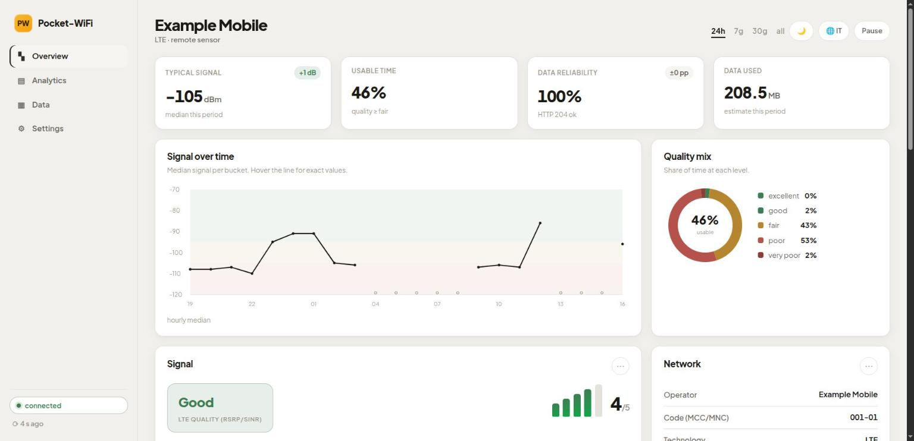
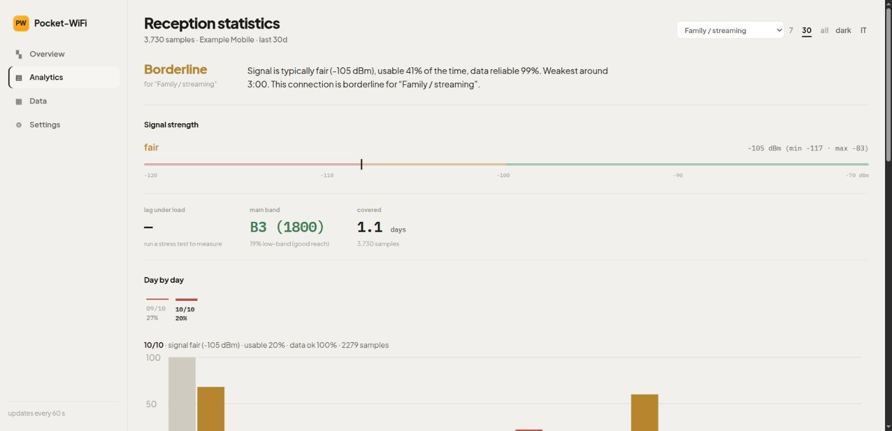
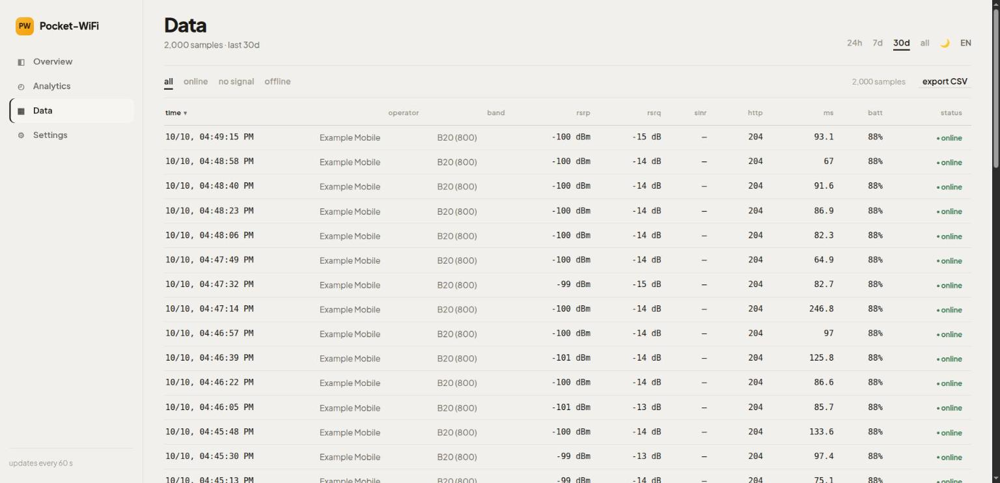

# Pocket-WiFi Monitor

Turn a spare Android phone with a SIM into a **remote mobile-network quality
sensor**. The phone reads signal, cell and connectivity with Termux:API, runs a
small reachability check and ships the samples to a computer at home over
Tailscale. The computer stores them locally and serves a web dashboard — so you
can tell, from anywhere, whether a place has good enough reception before you
commit to a SIM or a contract.


-success)


> **Status:** working prototype. The radio thresholds are heuristics; what you
> can read depends on the modem, the Android version and the carrier.

## Screenshots

**Overview** — the live view: KPIs, interactive signal chart, quality mix and
the realtime cards.



**Analysis** — the usage-profile verdict plus day-by-day and hour-of-day
patterns.



**Data** — a sortable, filterable table of every recent sample, with CSV export.



<sub>Screenshots use synthetic, anonymized data — no real carrier or cell is shown.</sub>

## What it does

- Measures **signal** (RSRP/RSRQ, band, cell), **connectivity** (does real
  traffic pass, and how fast does it respond) and **device health** (battery,
  temperature) at a chosen interval.
- Keeps working when the home PC is off: samples are written to a durable local
  outbox on the phone and **caught up** the next time the PC is reachable.
- Builds up a **history** so you can judge a spot over days, not seconds — with
  day-by-day and hour-of-day breakdowns to catch the weak evening hours.
- Gives a plain-language **verdict for a usage profile** (family streaming, 4K,
  remote work, …): "good / borderline / not enough".
- Runs an on-demand or scheduled **stress test** with an explicit data budget.
- No database, no cloud account, **no external Python packages** — standard
  library only.

## How it works

```text
Android phone                              Home PC
Termux + Termux:API                        collector.py
phone_agent.py  ──  HTTP over Tailscale  ─▶  data/ + web dashboard
```

- `agent/phone_agent.py` reads LTE, battery and connectivity, keeps a local
  outbox and retries samples whenever the PC is unreachable.
- `collector/collector.py` ingests single samples or batches, de-duplicates the
  historical view and serves the pages (`/`, `/stats`, `/explore`) and the APIs
  `/data`, `/history`, `/recent` and `/control` (remote stop and stress test).
- `agent/bands.py` holds only standard-library helpers for EARFCN, bands and
  quality classification.

## Project layout

```text
agent/        runs on the phone (Termux): phone_agent.py, bands.py, start scripts
collector/    runs on the PC: collector.py, dashboard.html, stats.html, start.sh, data/
tools/        PC-side utilities: stresstest.py, adb_signal.py
tests/        synthetic tests
docs/         PHONE.md (phone setup walkthrough)
```

## The three pages

- **Overview** (`/`) — the live view: four KPI cards (signal, usable time, data
  reliability, speed), an interactive signal-over-time chart, a quality-mix
  donut, the realtime signal/network/device cards and the remote controls.
- **Analysis** (`/stats`) — the verdict view: usage-profile recommendation,
  day-by-day and hour-of-day patterns, sensor uptime, conclusions, a dedicated
  4G/5G router upgrade estimate and a short glossary.
- **Data** (`/explore`) — a sortable, filterable, paginated table of every
  recent sample (time, operator, band, RSRP/RSRQ/SINR, HTTP, latency, battery)
  with CSV export.

Each page is a single self-contained HTML file (hand-rolled SVG charts, no chart
libraries), bilingual **EN/IT** and with a light/dark theme toggle.

## Run the collector (PC)

Requirements: Python 3.9+ and Tailscale. The code uses only the standard library.

```bash
cd collector
export POCKET_WIFI_TOKEN='put-a-long-random-token-here'
./start.sh
```

Open `http://127.0.0.1:8099`. For a manual invocation:

```bash
python3 collector/collector.py --bind 0.0.0.0 --port 8099 \
  --token "$POCKET_WIFI_TOKEN"
```

Find the PC's Tailscale address with `tailscale ip -4`. Generate a token with:

```bash
python3 -c 'import secrets; print(secrets.token_urlsafe(32))'
```

## Install the agent (phone / Termux)

This works on an old Xiaomi too; MIUI/HyperOS menu names may differ. The full
walkthrough is in [`docs/PHONE.md`](docs/PHONE.md).

1. Install **Termux** and **Termux:API** from F-Droid (same source/version).
2. Install Tailscale, join the same tailnet as the PC, confirm the PC answers at
   its `100.x.y.z` address.
3. In Termux:

   ```bash
   pkg update && pkg install python termux-api
   termux-setup-storage
   ```

4. Grant Termux:API the **Phone** and **Location** permissions. For readings to
   keep coming in with the screen off, set Location to **"Allow all the time"**
   and lift battery optimization for Termux and Termux:API.
5. Copy `phone_agent.py`, `bands.py` and `run_agent.sh` into the shared
   `Download` folder.
6. In Termux — **never put secrets in the copied files**:

   ```bash
   export POCKET_WIFI_COLLECTOR='http://100.x.y.z:8099'
   export POCKET_WIFI_TOKEN='the-same-token-as-the-PC'
   bash ~/storage/shared/Download/run_agent.sh
   ```

   Keep the phone charging; `run_agent.sh` holds a `termux-wake-lock` so it keeps
   sampling with the screen off.

### Auto-start after reboot

Install **Termux:Boot**, open it once, then:

```bash
mkdir -p ~/.termux/boot
cp ~/storage/shared/Download/boot-start-agent.sh ~/.termux/boot/start-agent.sh
chmod +x ~/.termux/boot/start-agent.sh
```

Store `POCKET_WIFI_COLLECTOR` and `POCKET_WIFI_TOKEN` in `~/.profile` (restricted
permissions), not in a public repo.

## Remote control & thermal safety

From the dashboard (or `POST /control`), even from outside the house, you can:

- **Stop / resume** the sensor: raises a flag the phone reads on its next cycle
  and exits cleanly.
- Launch an **on-demand stress test** (multi-stream download + latency under
  load) with a data budget chosen at the time; the result comes back on the
  dashboard.

The agent also has a two-stage **thermal safety**, useful when you are not on
site:

- **Warning** (`--max-temp`, default 44 °C): keeps monitoring but flags the
  sample as "hot" (shown on the dashboard).
- **Emergency** (`--shutdown-temp`, default 46 °C, for a few consecutive
  readings): raises an alert, releases the wake-lock so the phone sleeps and
  cools, and — **only if the device is rooted** — shuts it down.

Honest note: a **non-rooted** Android cannot power itself off from an app; there
the agent does the most it can (stop + sleep + alert) and the real last line of
defence is the phone's own hardware thermal protection.

## Interpreting the numbers

- **RSRP:** roughly `≥ -90 dBm` good, `-90/-100` fair, `-100/-110` poor, below
  `-110` critical.
- **SINR:** higher is cleaner/faster; near zero or negative can be slow even
  with an acceptable RSRP. (Many phones, including MIUI, don't report SINR.)
- A sub-GHz band (e.g. B20 / 800 MHz) tends to reach further and through walls,
  but does not guarantee high throughput on its own.
- `HTTP 204` proves traffic works, not how fast it is — use the stress test with
  an explicit budget for throughput.
- **Signal gaps at night** are usually a *reporting* gap, not lost data: with the
  screen off in deep sleep Android may stop returning cell info while uplink
  keeps working. See `docs/PHONE.md`.

## Security & data

This repo is meant to be public, but real samples are **not**: they can contain
the carrier, cell identifiers, timings and battery state. The `data/` directory
is git-ignored and ships only a `.gitkeep`.

The token travels in the `X-Token` header — never put tokens, Tailscale IPs,
carriers or real logs in scripts, issues or commits. The collector refuses to
start exposed without `--token` and protects both the write and the read APIs.
It speaks **plain HTTP**: confidentiality in transit relies on Tailscale's
WireGuard encryption. Don't expose the collector on a public interface without a
TLS reverse proxy; for defence in depth you can bind it to the Tailscale address
only:

```bash
python3 collector/collector.py --bind "$(tailscale ip -4 | head -1)" --token "$POCKET_WIFI_TOKEN"
```

## Optional tools

Signal over USB/ADB (no Termux):

```bash
python3 tools/adb_signal.py --loop --interval 5 --csv
```

Throughput and bufferbloat over USB tethering (defaults can use up to ~300 MB;
the `--budget-mb` cap is approximate to the downloaded-chunk granularity):

```bash
python3 tools/stresstest.py --budget-mb 100 --phase 20
```

## Extending it

To add a new sensor, keep the JSON sample contract: `timestamp`, `source`, your
metrics and `http_ok`. The collector accepts extra fields without migrations;
the dashboard uses the ones it recognises. Keep the transport separate from
collection so the outbox keeps working offline, and never put real data in
fixtures — use synthetic carriers, IDs and timestamps.

## License

Released under the **MIT** license: see [`LICENSE`](LICENSE). In short: use,
modify and redistribute freely, without warranty.
