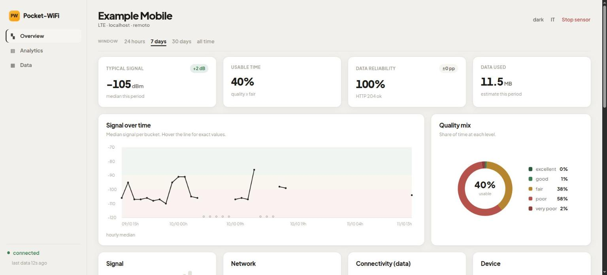
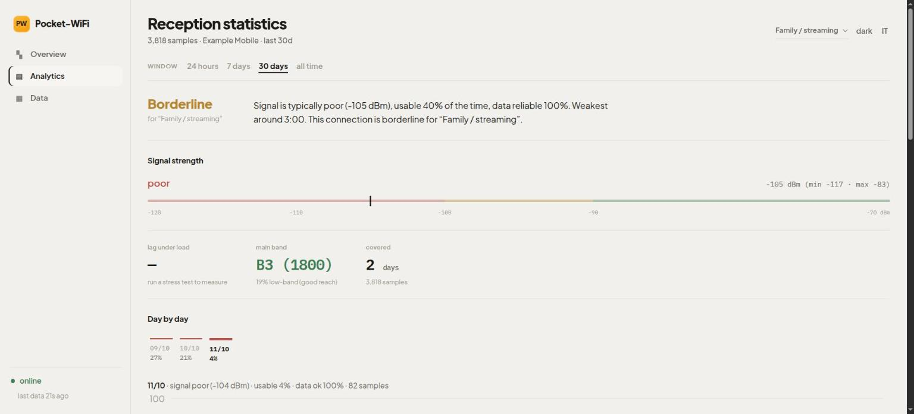
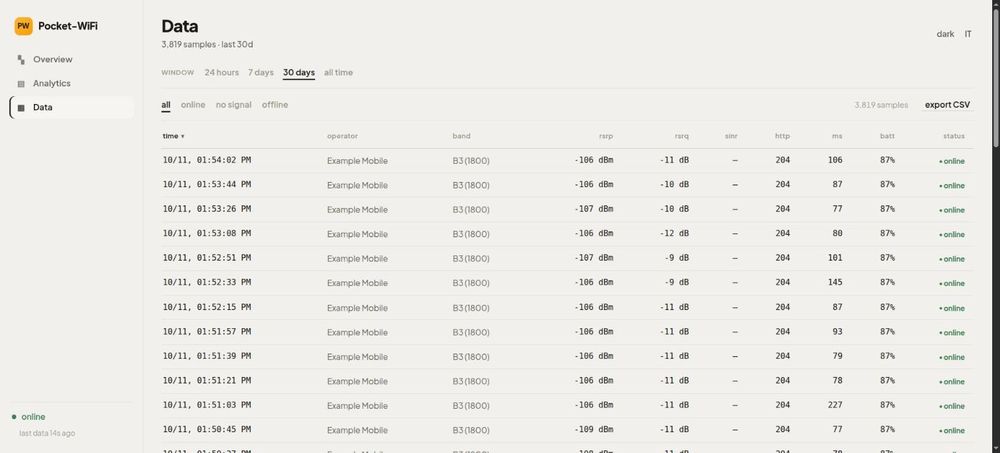

# Pocket-WiFi Monitor

English · [Italiano](README.it.md)

An old Android phone with a SIM becomes a remote sensor for mobile-network
quality. It measures signal and connectivity around the clock and sends the
samples to a PC at home over Tailscale, where a small web dashboard tells you
whether that spot is good enough before you commit to a SIM, a contract or a
4G/5G router.




## Quick start

On the PC (Python 3.9+, Tailscale):

```bash
export POCKET_WIFI_TOKEN="$(python3 -c 'import secrets; print(secrets.token_urlsafe(32))')"
cd collector && ./start.sh        # dashboard on http://127.0.0.1:8099
```

On the phone (Termux and Termux:API from F-Droid, Tailscale on the same tailnet):

```bash
pkg install python termux-api && termux-setup-storage
# copy agent/phone_agent.py, bands.py and run_agent.sh to Download/, then:
export POCKET_WIFI_COLLECTOR='http://100.x.y.z:8099'   # the PC's Tailscale IP
export POCKET_WIFI_TOKEN='same-token-as-the-PC'
bash ~/storage/shared/Download/run_agent.sh
```

Keep the phone on the charger. Permissions, battery settings and auto-start
after a reboot are covered in [docs/PHONE.md](docs/PHONE.md).

## Features

- Signal (RSRP, RSRQ, band, cell), real connectivity and latency, battery and
  temperature, sampled every few seconds.
- Nothing is lost when the PC is off: the phone keeps an outbox and catches up
  as soon as the PC is reachable again.
- Days of history with day-by-day and hour-of-day views, to spot the weak
  evening hours.
- A plain verdict for a usage profile (family streaming, 4K, remote work):
  good, borderline or not enough.
- Remote stop and an on-demand stress test with a data budget, plus a thermal
  cut-off for a phone left unattended.
- Python standard library and vanilla JS only. No database, no cloud account.

<table>
  <tr>
    <td></td>
    <td></td>
  </tr>
  <tr>
    <td align="center">Analysis: verdict and daily patterns</td>
    <td align="center">Data: every sample, filterable, CSV export</td>
  </tr>
</table>

<sub>Screenshots use anonymized data: no real carrier or cell is shown.</sub>

## How it works

```text
Android phone (Termux)                     Home PC
agent/phone_agent.py  ── HTTP over ──▶     collector/collector.py
local outbox            Tailscale          data/*.jsonl + dashboard
```

```text
agent/       runs on the phone: sampling, outbox, band decoding
collector/   runs on the PC: ingest, storage, the three dashboard pages
tools/       optional PC-side tools (ADB signal reader, tethering stress test)
tests/       unit tests on synthetic data
docs/        guides
```

## Documentation

- [Phone setup](docs/PHONE.md): permissions, screen-off readings, auto-start (Italian)
- [Usage](docs/USAGE.md): collector options, API, remote control, thermal safety, tools
- [Reading the numbers](docs/METRICS.md): the three pages and the signal scale
- [Development](docs/DEVELOPMENT.md): tests and the sample format

## Privacy

Real samples contain the carrier and cell identifiers, so `collector/data/` is
git-ignored. Every API needs the token in the `X-Token` header, and the
collector speaks plain HTTP: keep it on Tailscale, never on a public interface.

## License

[MIT](LICENSE)
